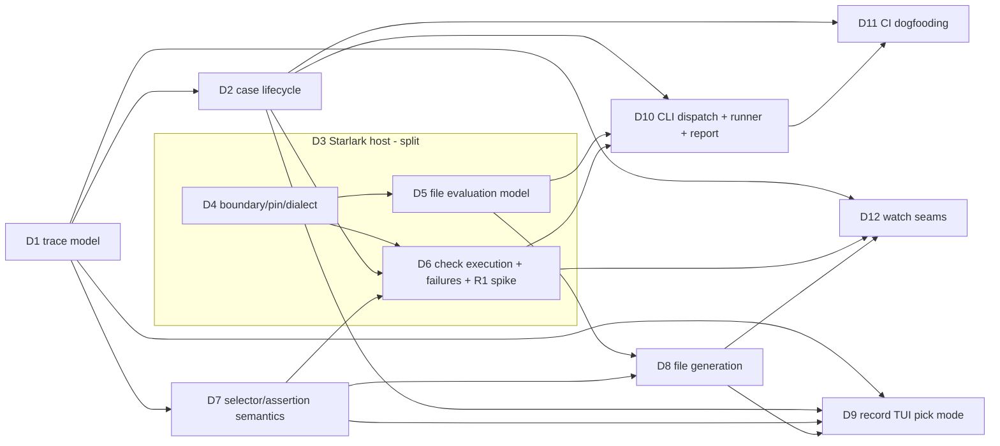

# Decision tree: trace-based testing
Source of truth: `../02-vision.md` (v4, approved per `../state.json`). Evidence: `../01-research/synthesis.md`.
Decisions: 12 files (11 open, 1 split parent), depth 2. All are `open`; no options have been written.

## Decisions
| ID | Question (short) | Status | Depends on | Parent |
|---|---|---|---|---|
| [D1](decisions/D1-trace-model.md) | What trace model does a check evaluate against, and what builds it from events? | decided (hybrid C+B: tui.Settle / CheckView over existing fold) | none | none |
| [D2](decisions/D2-case-lifecycle.md) | How does one case run end to end (pipeline, child, drain, completeness, timeout, outcome)? | decided (hybrid: B in-process runCase + C pgroup kill/deadline; exit table amendment pending human) | D1 | none |
| [D3](decisions/D3-starlark-host.md) | How is Starlark hosted? | split (all children D4, D5, D6 decided) | none | none |
| [D4](decisions/D4-starlark-boundary.md) | Package boundary, pinning, dialect and frozen builtin surface for go.starlark.net | decided (hybrid: B+C pin, A depguard/golden, TopLevelControl only) | none | D3 |
| [D5](decisions/D5-file-evaluation-model.md) | File evaluation: load time vs check time, `test()` registration, `load()`, `env()` | decided (hybrid: C core + A registry, env() load-time only) | D4 | D3 |
| [D6](decisions/D6-check-execution-failures.md) | Check execution and failure collection without try/except (**holds the R1 spike**) | decided (hybrid: A base + C fixed MaxSteps + B callee-column + typed Failure; vision amendments pending) | D2, D4, D7 | D3 |
| [D7](decisions/D7-selector-assertion-semantics.md) | Exact selector and assertion semantics over spans | decided (hybrid C base + A where/description + B pure-Go matcher) | D1 | none |
| [D8](decisions/D8-recorded-file-generation.md) | How `--record` generates the Starlark file, and its guarantees | decided (hybrid: B string-built generator in internal/praytest, selector.Literal, narrow volatile list, absence picks commented out; vision amendments pending) | D5, D7 | none |
| [D9](decisions/D9-record-tui-pick-mode.md) | Record-mode TUI: span cursor, pick panel, keys, where recorder state lives | decided (C base + internal/record, Recorder interface, ~270 lines in tui; no CheckSpan move) | D1, D2, D7, D8 | none |
| [D10](decisions/D10-cli-dispatch-runner.md) | `praytel test` dispatch/parsing, runner placement, report and exit aggregation | decided (hybrid on C: argv[0] check + args.ParseTest + internal/testrun, no Reporter/registry) | D2, D5, D6 | none |
| [D11](decisions/D11-ci-dogfooding.md) | CI dogfooding: required `trace-tests` job, determinism proof and guards | decided (hybrid on B: Dagger fn + exported report, nightly workflow 20x+20x, new go test -race job) | D2, D10 | none |
| [D12](decisions/D12-watch-extension-seams.md) | Which v1 seams v1.1 `--watch` needs (thin) | decided (hybrid on B: no v1 code, four enforced seams + do-not-build rule; v1.1 gated by 2-day spike) | D1, D6, D8 | none |

## Graph (edge = "is needed by")

Acyclic: every edge goes from a lower wave to a higher wave below.

## Resolution order (waves; decisions in one wave can be resolved in parallel)
| Wave | Decisions | Notes |
|---|---|---|
| 1 | **D1**, **D4**, plus the **R1 spike** | No dependencies. The spike (multiple `expect.*` failures recorded from host builtins in one thread; what `run.one` can return on failure; Cancel/step-cap behaviour; which frame's position is reported from a helper in a loaded file) needs only a pinned go.starlark.net. It produces evidence for D6 and validates A3. |
| 2 | **D2**, **D5**, **D7** | D2 and D7 need D1's model; D5 needs D4's dialect/boundary. |
| 3 | **D6**, **D8** | D6 consumes the spike, D2's timeout scope and D7's semantics. D8 needs D5's file shape and D7's selector forms. |
| 4 | **D9**, **D10**, **D12** | Independent of each other. |
| 5 | **D11** | Needs the final command shape (D10) and lifecycle determinism guarantees (D2). |

Critical path: D1 → D7 → D6 → D10 → D11 (and D1 → D7 → D8 → D9 for the record flow).

## Where the vision's early spike belongs
The R1 spike ("Starlark records-and-continues") belongs to **D6** (child of D3). It is scheduled in **wave 1**, not wave 3: it depends only on having go.starlark.net available, not on D4's final pin. If the spike shows host builtins cannot record and continue, A3's fallback applies (first failure per case only), which changes D6's criteria scores and the S2/S3 report wording in D10, but no other decision's question.

## Defaults assumed (not decisions: obvious, fixed by the vision, or cheap to change)
- **Input expansion algorithm** (S3): implemented exactly as the vision specifies with `filepath.WalkDir` (skip dot-dirs, do not follow symlinked dirs), `filepath.Glob` for arguments containing `*?[` that are not existing paths, bytewise sort per argument, dedupe on `filepath.Abs` + `Clean`, first position wins. A symlink to a regular file under a directory is included. Belongs to D10's implementation, not its question.
- **Sequential execution**, files in expansion order, cases in file order; no parallelism (S3, R11).
- **Report streams to stdout**; praytel's diagnostics and replayed child output go to stderr (matches `--snapshot`, `docs/reference/praytel.1.md:128-141`).
- **Report wording** exactly as S2/S3/S4 (`ok`, `FAIL`, `INCOMPLETE`, summary lines).
- **Usage error wording** exactly as the vision's quoted messages; all exit `1`.
- **Exit code of record mode**: like `--tui` today (the child's code), `1` for refusals before start. The vision does not state it; changing it later is cheap.
- **`test` flag set** is the vision's list (`--record`, `--grpc-port`, `--http-port`, `--drain-idle`, `--drain-timeout`) with the same defaults as the root flags; `--max-spans`/`--max-log-lines` can be added later without breaking anything.
- **Case defaults**: `exit_code = 0`, `timeout = "10m"` (§4).
- **`shop -card TYPE`**: places only order A-1001 with that card; the default four orders are unchanged (A5), so existing goldens and demo recordings are untouched.
- **Docs files**: `docs/reference/praytel-test.1.md`, `docs/reference/praytest.5.md`, `docs/guides/trace-tests.md`, with the frontmatter rules in `CONTRIBUTING.md:3-9`; plus one sentence and two synopsis lines in `docs/reference/praytel.1.md`.
- **Tracing rule** for new packages: exported functions start spans per `CONTRIBUTING.md:16-45`; nothing per span, per assertion or per TUI frame.
- **Language**: Starlark via go.starlark.net is mandated; not re-decided.
- **Branch protection** for `trace-tests` is a manual admin action (A7), recorded as a task, not a design decision.
- **Licence/dependency review** for go.starlark.net (BSD-3-Clause) passes the existing dependency workflows; a task, not a decision.

## Observations for the decider (from mapping; not decisions)
- The vision is internally inconsistent on selector fields: §4 lists `service`, `name`, `attrs`; S2 uses `spans(service=, status=)`. Raised in D7.
- The `--snapshot` completeness rule lives inside `internal/render/tui` (`snapshot.go:55-95,165-198`), coupled to the TUI model. Reusing it from `praytel test` is D1's central tension.
- The TUI has no span cursor and every rune goes to the search (`internal/render/tui/tui.go:264-307`); S1's pick flow is a larger TUI change than "a status-line addition". Raised in D9.
- `SpanClosed` carries no span payload (`internal/domain/event.go:38-42`); relevant to D1 and D12.
- `check.yml` has only a weekly cron (`.github/workflows/check.yml:19-20`); M2's nightly repeat needs a new schedule. Raised in D11.
- `02-vision.md`'s header still reads "awaiting human confirmation"; `state.json` records approval of v4. Treated as approved.

## Cap
12 decision files used (the ~12 cap). No scope cut was needed. If a later split pushes past the cap, cut in this order: (1) fold D12 into criteria on D1/D6/D8 (it is a constraint list, not an architecture choice); (2) keep D9 unsplit and let its interaction details (exact keys) be settled as defaults during implementation; (3) keep input expansion as a default inside D10.
