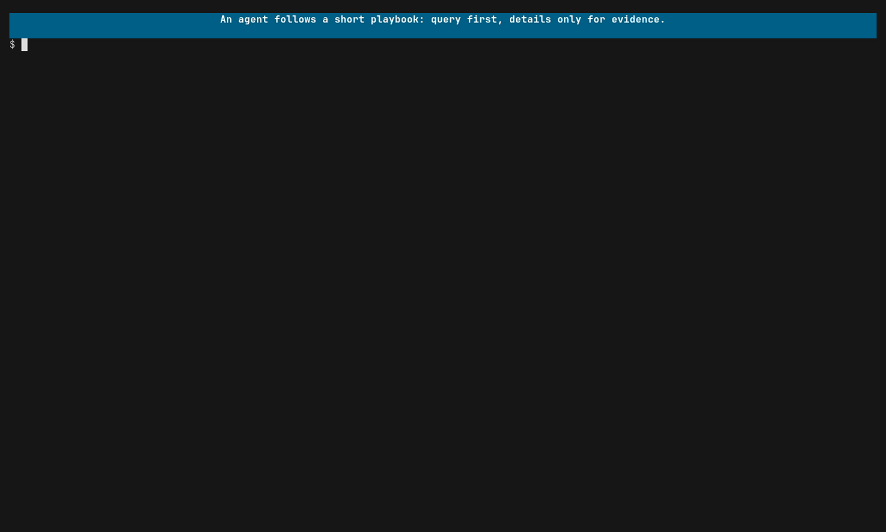

# Using praytel with agents

An agent that reads only test output knows whether the tests passed. An agent
that can run a command under praytel knows what the code actually did: which
spans ran, what they logged, and whether the hard part was wired up or only
stubbed. That is what lets you build an app with an agent and trust the result.

[](../assets/agents.mp4)

The recording shows the command-line form of what an agent does through the
MCP tools: the same queries, evaluated by the same engine.

## Connect an MCP client

`praytel mcp` runs a stdio MCP server rooted at its working directory.
Configure the client to launch it:

```json
{"command":"praytel","args":["mcp"]}
```

The server owns several bounded, in-memory runs for that one client. Each run
wraps one child, leaves no files, and is cancelled when the server exits. The
child's inherited environment and raw output are never exposed to the agent;
it sees joined telemetry.

[Example 5](../examples.md#5-agents) has the queries from this guide in a form
you can run yourself before handing them to an agent.

## The investigation loop

The tools use progressive disclosure, so an agent searches compact evidence
before loading span or log detail:

1. `start_run` with a focused [typed query](queries.md) and bounded limits.
2. `wait_for_matches` until items arrive, the run is terminal, or `timed_out`
   is true.
3. `get_trace_topology` to inspect a trace's shape before asking for detail.
4. `get_span_details` and `get_logs` only for the IDs that look suspicious.
5. `stop_run` when verification of a long-running process is complete.

Each tool is described in [praytel-mcp(1)](../reference/praytel-mcp.1.md).

## Focus the agent on the area of change

`start_run` requires a query, and that query is the focusing tool. A whole
test suite's telemetry would drown an agent's context; a query scoped to the
code it just touched returns a handful of evidence records.

Tell the agent to scope its query to what it changed:

```
span{ resource.service.name = "checkout" && span:status = error }
span{ span:name =~ "Orders\\..*" } >> log{ log:severity_number >= 17 }
```

The first asks whether anything in the changed service failed. The second asks
for error-level logs anywhere beneath the changed section.

## Check that the work is real

An agent can make a test pass by stubbing the thing the test was meant to
exercise. The trace shows it. Ask for evidence that the real path ran:

```
span{ span:name = "Orders.Repo.Save" } > span{ span:kind = client }
```

This matches only if saving an order made an outbound call. No match, on a
complete run, means the call never happened.

The same idea checks structure. `get_trace_topology` returns the skeleton of a
trace without attributes or log bodies, which is enough for an agent, or you,
to see how the system was actually put together. For the human view of the
same thing, see [Get an overview of a system](overview.md).

## When "no match" is a real answer

A "no match" conclusion is valid only after the run is terminal (`run_state` is
exited or failed), `truncated` is false, and `incomplete_reasons` is empty.
Before that, the telemetry may simply not have arrived yet.

## Performance checks

A duration query turns a trace into a pass/fail check an agent can run after a
change:

```
span{ span:name = "POST /orders" && span:duration > 200ms }
```

On a complete run, no match means the budget held; a match hands the agent the
slow span and its path to investigate. See
[Focus on performance](performance.md) for more query shapes.

Treat this as a guard rail rather than a benchmark. It is one run on one
machine, so set the budget well clear of normal variation and expect an
occasional false alarm.

## Put the playbook in a skill

`praytel agent instructions` prints the concise version of the investigation
loop, suitable for pasting into an agent skill or system prompt. See
[praytel-agent(1)](../reference/praytel-agent.1.md).
