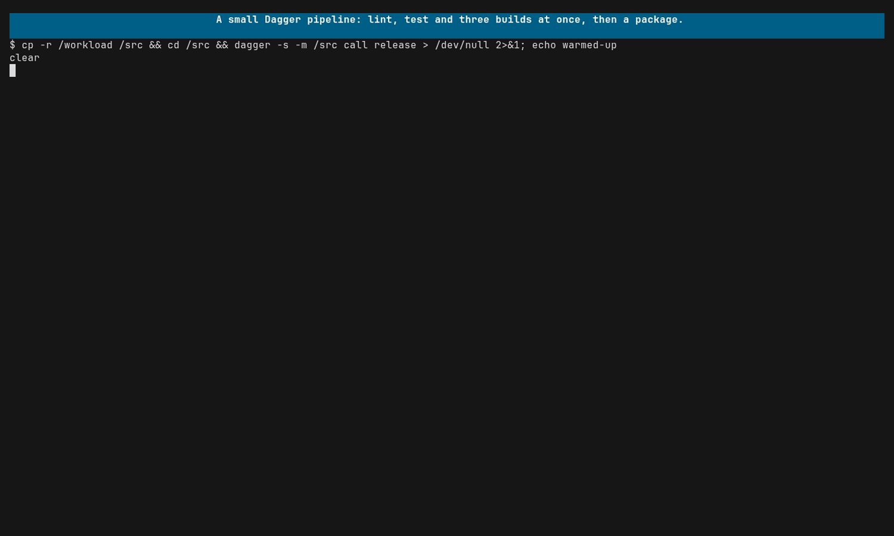

# Use the graph view

The graph view draws what a run actually did: one box per kind of span, one
arrow per kind of call between them. [Get an overview of a system](overview.md)
covers why that is useful. This guide is about using it: opening it, reading
it, moving around a big one, and cutting it down to the part you care about.

The example is a [Dagger](https://dagger.io) pipeline. Dagger is a good
subject because it is a real tool with three moving parts (a CLI, an engine
and your own pipeline code), it exports OpenTelemetry without any setup, and
its graph is big enough that you need the rest of this guide to read it.

## Run it

[](../assets/graph.mp4)

```sh
praytel --tui -- dagger -s call release
```

## Try it yourself

You need [Dagger](https://docs.dagger.io/install), a container runtime and
praytel. The pipeline is in this repository, in
[`demo/workloads/ci`](../../demo/workloads/ci):

```sh
cd demo/workloads/ci
praytel --tui -- dagger -s call release
```

`release` checks and builds a tiny Go app. Lint, test and a build for each of
three platforms run at the same time, then the binaries are packaged into one
archive. Each step opens a span of its own, so the steps show up as boxes; see
[`.dagger/main.go`](../../demo/workloads/ci/.dagger/main.go).

`-s` silences Dagger's own progress output. Its spans tell the same story, and
without `-s` the tree starts with a long block of Dagger's progress text.

The first run also generates the module's code and pulls images, so its graph
is larger. Run the command a second time to see the pipeline on its own.

## Open the graph

Press Ctrl-G. Press it again to go back to the tree. You can switch at any
time, including while the command is still running; the graph grows as spans
arrive. The search carries over between the two views.

## Read the graph

Each box is a span name in one service, labelled `service.span name`, with
the number of spans that ran under that name. The service comes from the
`service.name` resource attribute. A Dagger run has three:

| Boxes starting | Are | For example |
|---|---|---|
| `dagger-cli.` | The `dagger` command itself: connecting, starting the engine, loading the module. | `dagger-cli.connect` |
| `unknown_service:dagger-engine.` | The engine: every API call your pipeline makes, image pulls, file syncs. | `unknown_service:dagger-engine.Container.withExec` |
| `dagger-go-sdk.` | Your pipeline's own code, here the spans `.dagger/main.go` starts. | `dagger-go-sdk.build` |

The engine sets no `service.name`, so it gets the OpenTelemetry default of
`unknown_service:` followed by the process name. That is what an unnamed
service looks like in your own apps too.

The graph reads left to right. The box on the far left is the root: for
Dagger, the command line, `dagger-cli.dagger -s call release`. Callers sit to
the left of what they call.

| You see | It means |
|---|---|
| `3 spans` in a box | Three spans ran under that name. |
| `×3` on an arrow | That call was seen three times. An arrow without a count was seen once. |
| A coloured box | This span calls others. Its arrows leave in the same colour, and the tree draws its bar in that colour too. |
| A grey box | This span calls nothing. |
| A solid arrow | A call. |
| A dashed arrow | A call that closes a cycle: somewhere, the box it points to also leads back here. |

In the Dagger graph, the three platform builds share the span name `build`,
so they are one box, `dagger-go-sdk.build`, with `3 spans`. Their calls into
the engine carry `×3`.

Dagger's graph also has a cycle. The CLI sends its query to the engine's
`POST /query`, which runs `Ci.release`, which runs the module's `release`.
The module then makes its own API calls, which go back through
`POST /query`. One of those arrows has to point back the way it came, and it
is drawn dashed.

A span that calls another of the same name, as a retry or recursion does,
adds to its box's count rather than drawing an arrow back to itself.

## Move around

A graph is usually bigger than the terminal. The Dagger one is several
screens wide.

| Key | Action |
|---|---|
| ↑ / ↓ (or Ctrl-K / Ctrl-J) | Scroll one line. |
| PgUp / PgDn | Scroll one page. |
| ← / → (or Ctrl-B / Ctrl-F) | Pan left or right. |
| Home | Back to the left edge, where the root is. |

## Scope a big graph

The graph always shows the same spans the tree does, so the search narrows
it. There are two searches, and Tab switches between them. Both are
case-insensitive and forgiving: the letters you type have to appear in that
order, but not necessarily next to each other. Esc clears the search.

**Searching traces** (the default) keeps the traces with a span whose name or
attributes match, and highlights the matching letters in each box's label.
That works best for a server or a test run, where each request or test is a
trace of its own: type `gift` against `shop` and the graph is one order. A
`dagger call` is a single trace, so this search keeps the whole run, but the
highlights still show you where the matching boxes are.

**Searching logs** (press Tab) keeps only the spans whose logs match, and the
spans above them. That cuts out whole branches, and it is how to read
a tool that does all its work in one trace. In the Dagger pipeline, each
build reports what it built with `go version -m`, which prints
`CGO_ENABLED=0`. Press Tab, type `CGO_ENABLED=0`, and the graph is the path
through the engine and `release` to the three builds.

Matches are made one character at a time, so a short or common query can match
logs you did not mean. Pick something only the logs you want contain, as
`CGO_ENABLED=0` is here. The search box does not take spaces yet.

## Make your own graphs readable

The graph is built from span names, so it is only as clear as they are.

- **Name a span for the step, not the item.** The Dagger builds are one box
  because each is named `build`, not `build linux/amd64`. Put the item in an
  attribute. A name with an ID or a value in it makes a box per value.
- **Set `service.name` in every service.** Otherwise its boxes are
  `unknown_service:...`, as Dagger's engine is.
- **Open a span per step you want to see.** Dagger shows the engine calls on
  its own, but `lint`, `test`, `build` and `package` are boxes only because
  the module starts a span for each.
