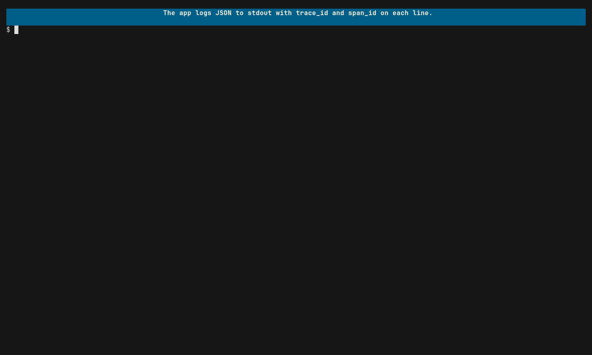

# View logs correlated to traces

A trace tells you where time went. A log line tells you what the code thought
was happening. They are usually in two places. Praytel joins them, so each log
line sits under the span that emitted it.

## Run it



```sh
praytel -- ./server           # append-only stream
praytel --tui -- ./server     # logs nested in the span tree
```

[Example 1](../examples.md#logs) shows the same app's logs raw and then
joined.

## How a line gets joined

Praytel reads the child's stdout and stderr line by line and accepts logs
exported over OTLP. A line is attached to a span when it names one:

| Log shape | What praytel reads |
|---|---|
| JSON object | The `trace_id` and `span_id` keys. |
| logfmt | The `trace_id` and `span_id` keys. |
| OTLP log record | The record's trace and span IDs. |

```
{"msg":"charge declined","trace_id":"e36345b5...","span_id":"afba9044..."}
level=warn msg="charge declined" trace_id=e36345b5... span_id=afba9044...
```

So the one change to make in your app is to put the active trace and span IDs
on every log line. Most logging libraries have an OpenTelemetry hook that does
this. Colour codes from pretty console writers are stripped before parsing.

## Lines that cannot be joined

Unstructured lines are not an error; they are still shown. Praytel never
guesses which span an untagged line belongs to. Instead:

- a line with no IDs goes to a global `orphan` group;
- a line with only a `trace_id` goes to that trace's own orphan group;
- a line naming a span praytel has not seen yet waits for that span, or for
  the end of the run.

If the same message arrives on stdout and over OTLP, both copies are kept.

## Reading the stream

```
stdout orphan          78db31e8... 7fa53bec... plain line
stdout checkout.Charge e36345b5... afba9044... {"msg":"grpc-span", ...}
```

The columns are the source (`stdout`, `stderr` or `otlp`), the span the line
belongs to, the trace and span IDs, and the line itself. The stream only ever
appends. A line that arrives before its span can be printed again once it has
been joined.

## Searching logs in the TUI

Press Tab to switch the search from traces to log bodies. Press Tab again to go
back.

## Limits

`--max-log-lines` caps retained lines (one million by default), with the same
evict-then-shed behaviour as spans.
