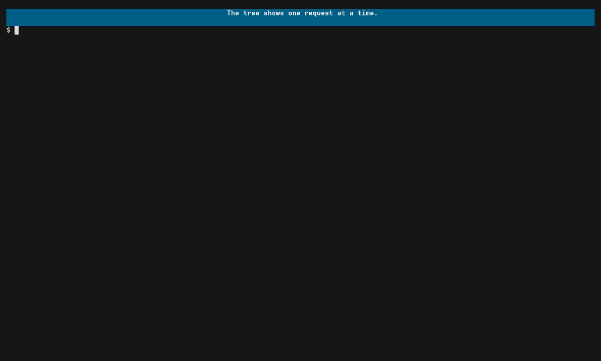

# Get an overview of a system

The span tree shows one request at a time. The graph view shows the shape of
the system: which components were hit and which ones call which. It is drawn
from what actually ran, not from a diagram someone wrote.

That answers three kinds of question:

- **What components does this hit?** Run one command or one test and see
  everything it touched.
- **How did your agent actually structure your system?** Run the code an agent
  wrote and compare the graph to what you asked for.
- **How do the tools you use work?** Wrap an instrumented tool and watch what
  it talks to.

## Run it

[](../assets/overview.mp4)

```sh
praytel --tui -- ./server
```

Press Ctrl-G to switch from the tree to the graph. Press it again to go back.

## Try it yourself

### The example 'shop'
With the example `shop` app [installed](traces.md#the-shop-app), run:

```sh
praytel --tui -- shop
```

Press Ctrl-G. There is one box per span name, labelled with its service:
`web.Orders.Create` calls `checkout.Orders.Place`, which fans out to
`inventory.Stock.Reserve`, `payments.Gateway.Charge` and
`checkout.Orders.Repo.Save`. Compare it with the calls in
[`main.go`](../../demo/workloads/shop/main.go). The arrow into
`checkout.Orders.Repo.Save` reads `×3`, not `×4`: one order never saved. Type
`gift` and the graph shrinks to what that order touched, with
`inventory.Stock.Release` in place of the save.

## Reading the graph

Each box is one span name in one service, with the number of spans that ran
under that name. An arrow from A to B means a span named A was the parent of a
span named B; `×3` on an arrow means that call was seen three times. A span
that calls another of the same name, as a retry or a recursion does, adds to
its box's count rather than drawing an arrow back to itself.

| You see | It means |
|---|---|
| A coloured box | This span calls others. Its arrows leave in the same colour, and the tree view draws its bar in that colour too. |
| A grey box | This span calls nothing. |
| A solid arrow | A call. |
| A dashed arrow | A call that closes a cycle: somewhere, B also leads back to A. |

Calls leaving one box share a trunk and branch off to each target, so a box
with many callees stays readable.

## Where the boxes come from

A box is labelled with the service, from the `service.name` resource
attribute, followed by the span name: a span named `Orders.Repo.Save` in
service `checkout` is the box `checkout.Orders.Repo.Save`.

Every distinct span name gets a box, so the graph is only as good as your
naming. Give each operation a stable name and set `service.name` per service,
and the graph reads like your design. Name every span `handler` and you get
one box; put an order ID in the span name and you get a box per order.

## Scope the graph

The graph always shows the same spans the tree would. Type to search, and the
graph shrinks to the matching traces.

Scroll with the arrow keys, including left and right for wide graphs.
