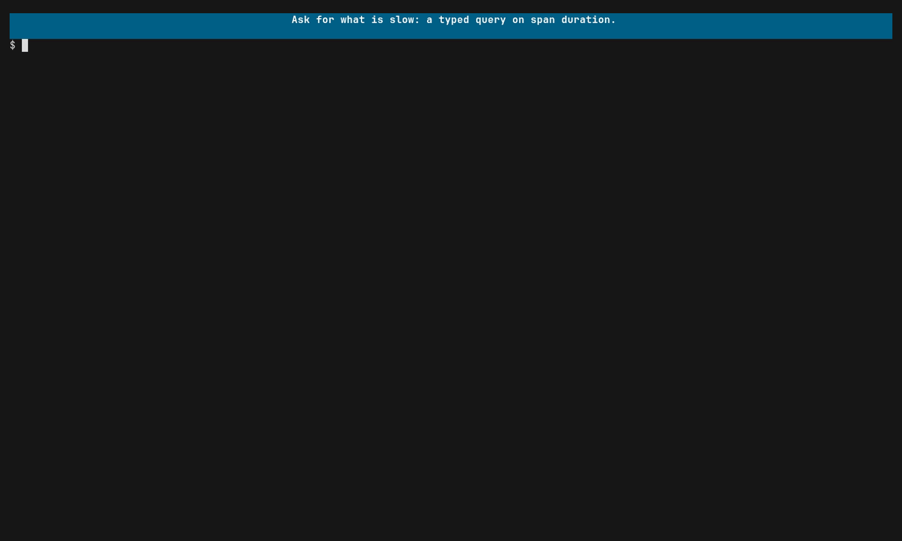

# Focus on performance

Every span carries a duration, so a run under praytel is already a profile of
your system at the level you instrumented it. Typed queries let you ask for the
slow parts directly instead of scanning the tree for big numbers.

The query language is shaped like TraceQL, but it is praytel's own small
dialect and is not compatible with Tempo's.

## Show only what is slow



```sh
praytel --tui --query 'span{ span:duration > 100ms }' -- ./server
```

The tree now holds only the traces with a span over 100ms. By default you get
the **path**: each slow span, its ancestors, its descendants and their logs.
That is usually what you want, because the slow span is rarely the cause; one
of its children is.

Change the view to change how much comes back:

| Query ending | You see |
|---|---|
| (nothing) or `\| path` | Slow spans with their ancestors, descendants and logs. |
| `\| matches` | Only the slow spans. |
| `\| trace` | The whole of every trace that contains a slow span. |

## Ask a narrower question

Slow spans in one service:

```sh
praytel --query 'span{ resource.service.name = "checkout" && span:duration > 100ms }' -- ./server
```

Slow calls made beneath a particular entry point (`>>` means any descendant):

```sh
praytel --query 'span{ span:name = "POST /orders" } >> span{ span:duration > 100ms }' -- ./server
```

Slow outbound calls only:

```sh
praytel --query 'span{ span:kind = client && span:duration > 250ms }' -- ./server
```

Whole requests that were slow, however the time was spent:

```sh
praytel --query 'span{ trace:duration > 1s } | trace' -- ./server
```

Slow spans that also logged a retry:

```sh
praytel --query 'span{ span:duration > 100ms } > log{ log:body *= "retry" }' -- ./server
```

## Get numbers out

For a script, drop `--tui` and choose a format:

```sh
praytel --query 'span{ span:duration > 100ms } | matches' --format ndjson -- go test ./...
```

For a server that never exits, emit each trace once it has gone quiet rather
than waiting for the end:

```sh
praytel --query 'span{ span:duration > 100ms }' --emit settled --format ndjson -- ./server
```

A settled trace is provisional; late data can produce a newer revision.

## What this is not

A span duration is one measurement from one run, on your machine, at the
granularity you instrumented. It tells you where to look. It is not a
benchmark: for a number you would defend, repeat the run and compare.

## Next

[Using praytel with agents](agents.md). The full language is in
[Typed queries](queries.md) and
[praytel-query-language(7)](../reference/praytel-query-language.7.md).
