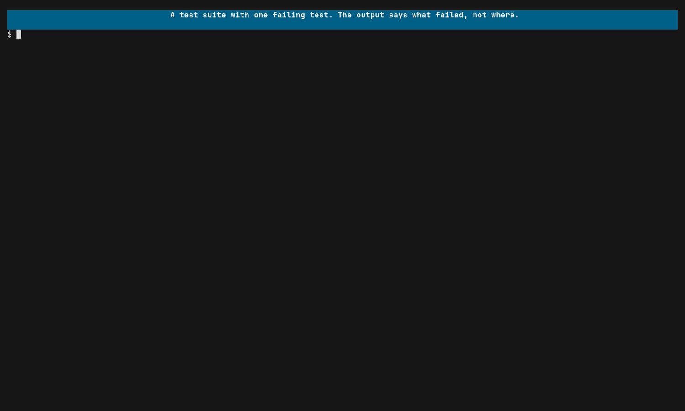

# View traces of tests

A failing assertion tells you what was wrong at the end. The trace tells you
where it went wrong on the way there: which call returned the error, what it
logged, and what ran before it.

## Run it

[](../assets/tests.mp4)

```sh
praytel --tui -- go test ./...
```

Any test runner works; praytel only wraps the process. The OTLP environment
variables are inherited by the test binaries the runner starts.

Praytel exits with the runner's exit code, so it is safe in scripts and CI: a
failing suite still fails.

## Try it yourself

The example [`shop` app](traces.md#the-shop-app) has three tests;
`TestGiftCardOrderIsConfirmed` fails on purpose.

```sh
cd demo/workloads/shop
praytel --tui -- go test -count=1 .
```

Each test is its own trace, named after the test. Type `TestGift`, then follow
the `×` marks: the test, `Orders.Create`, `Orders.Place`, `Gateway.Charge`,
and last `Gateway.Bank.Authorize`, with `authorization refused` logged beneath
it. That span is where the test failed. Praytel exits 1, as `go test` did.

To cut the run down to the payment path:

```sh
praytel --tui --focus 'Gateway*' -- go test -count=1 .
```

## What the tests need

The code under test must export spans, exactly as in
[View traces from a running app](traces.md). Two things make test traces much
more useful:

- **Start a span per test**, named after the test. Then each test is its own
  trace, and you can search for it by name.
- **Record errors on spans.** A span that ends with an error status is drawn
  with `×`, which is what points at the failing call.

Flush the exporter before the test process exits. Praytel waits briefly for
late data after the child exits (`--drain-idle`, capped by `--drain-timeout`),
but it cannot receive spans that were never sent.

With Go, add `-count=1` when you want traces from tests whose results are
cached. A cached test does not run, so it exports nothing.

## Find where it failed

1. Type part of the test's name to bring up its trace.
2. Follow the `×` marks down the tree. The deepest one is the call that
   failed. Whether its callers are marked too depends on whether your code
   records the error at each level.
3. Read the log lines under that span. See
   [View logs correlated to traces](logs.md) if they are not attached.

## Narrow a large suite

`--focus GLOB` admits only the span paths matching a glob, and `--exclude GLOB`
drops matching names afterwards. Both repeat.

```sh
praytel --tui --focus 'checkout*' --exclude '*healthcheck*' -- go test ./...
```
