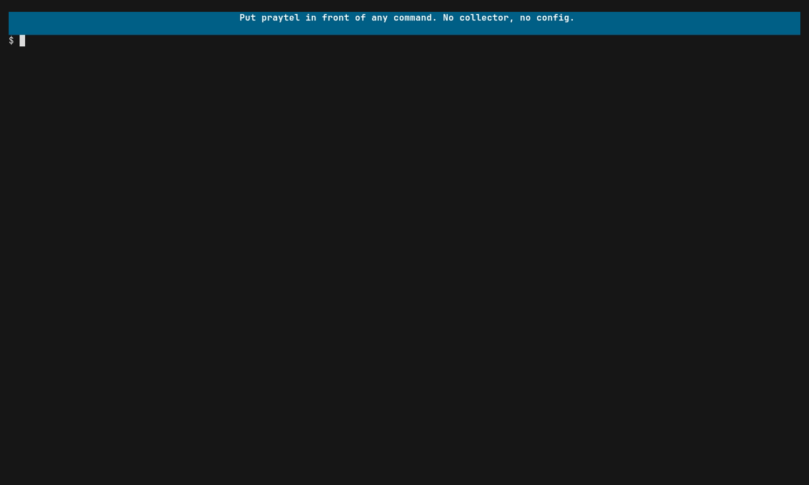

# View traces from a running app

Tracing usually means a collector, a backend and a browser tab, so it only gets
looked at when something is already on fire. Praytel puts the traces in the
terminal you started the app from. Make that part of how you run things and you
get two payoffs: you understand the apps you use, and the traces are already
good when something does go wrong.

## Run it



```sh
praytel --tui -- ./server
```

Everything after `--` is your command, run unchanged. Praytel forwards signals
to it and exits with its exit code, so it can sit in front of anything you
already run.

## What the app needs

The app must export OpenTelemetry traces over OTLP. Praytel starts a receiver
and points the child at it through the standard `OTEL_EXPORTER_OTLP_*`
environment variables, so an OpenTelemetry SDK that configures its exporter
from the environment needs no code change.

There is no collector to run. If one is already listening on the default ports
(4317 for gRPC, 4318 for HTTP), move praytel:

```sh
praytel --tui --grpc-port 14317 --http-port 14318 -- ./server
```

An app with no instrumentation still runs normally; you will see its output but
no spans.

## Reading the tree

Each trace is a tree of spans. Every span shows its state and how long it took.

| Mark | Meaning |
|---|---|
| spinner | The span is still open. |
| `●` | The span closed without error. |
| `×` | The span closed with an error status. |

A duration prefixed with `~` is an estimate for an open span whose start time
has not been reported yet.

## Finding things

Type to search. The match is loose on purpose: letters only need to appear in
order across span names and attributes, and one matching span surfaces its
whole trace. The characters that matched are highlighted so you can see why a
trace showed up. Esc clears the search, the arrow keys scroll, and Ctrl-C
quits. The full key list is in
[praytel(1)](../reference/praytel.1.md#tui-keys).

The TUI stays open after the app exits, so you can keep reading.

## Long-running and chatty apps

Praytel holds everything in memory. `--max-spans` caps what it keeps (one
million by default). At the cap it evicts the oldest closed traces first and
says so on stderr.

## Next

[View logs correlated to traces](logs.md).
